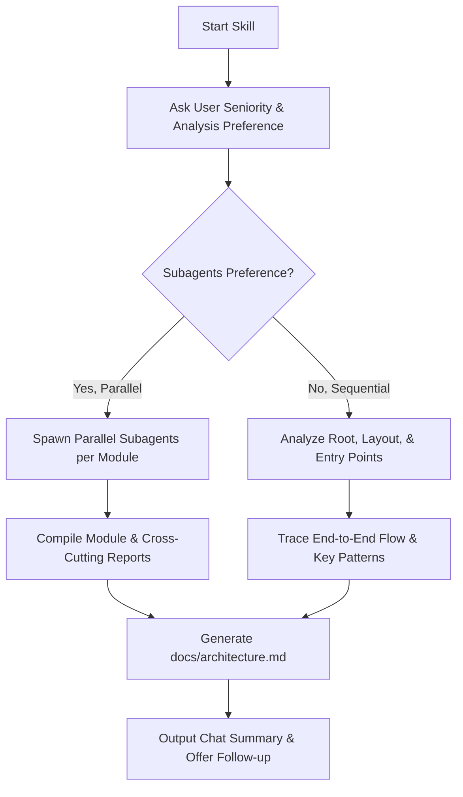

# Explain Architecture Claude Skill

A professional custom skill for Claude and AI coding agents designed to analyze codebases, explain their architecture tailored to the developer's seniority level, and generate a comprehensive architecture report.

## 🚀 Overview

Understanding a new or complex codebase can be time-consuming. This skill automates the process by:
1. **Assessing Your Background**: Tailoring the explanation depth to your seniority (Beginner, Intermediate, or Senior).
2. **Flexible Analysis**: Supporting both sequential file analysis and parallel analysis using subagents for large codebases.
3. **Structured Documentation**: Generating a detailed, standardized Markdown report saved directly in your project under `docs/architecture.md`.

---

## 🛠️ How It Works

### 1. Initial Assessment
The agent will prompt you with two simple questions before analyzing:
- **Experience Level**: 
  - **Beginner**: New to the stack, focused on analogies and simple concepts.
  - **Intermediate**: Knows the basics, looking for patterns and architectural decisions.
  - **Senior**: Deep stack knowledge, seeking trade-offs, pain points, and non-obvious choices.
- **Analysis Execution**: Sequential analysis (single agent) or Parallel analysis (multiple subagents for large modular systems).

### 2. Codebase Investigation
The agent performs a deep dive into the repository:
- **Structure & Configs**: Inspects root files (`package.json`, `pom.xml`, `build.gradle`, `README.md`).
- **Layers**: Identifies key directory structures and architecture styles (monolith, microservices, modular monolith).
- **Entry Points & Flow**: Traces user-facing routes, controllers, and core request flows.
- **Cross-cutting Concerns**: Analyzes Authentication, Event Messaging (e.g. Kafka), database integrations, and error propagation.

### 3. Architecture Report Generation
A comprehensive report is written to `docs/architecture.md` containing:
- **Project Overview & Tech Stack**: A summary table of versions and design choices.
- **ASCII Diagrams**: Visualizing high-level services, connections, data flows, and event topics.
- **Module & Data Model Breakdown**: Detailed service reviews, database tables/entities, and relationship diagrams.
- **End-to-End Request Flow**: Step-by-step trace of a representative action.
- **Design Patterns & Pain Points**: Practical patterns in use and potential technical debt (tailored for Intermediate/Senior developers).

---

## 📥 Installation & Usage

### 1. In AI Assistant / Desktop App
Simply place or link the `SKILL.md` file into your agent's skills directory:
- Custom Agent system instructions.
- Desktop application configurations.

### 2. Manual Invocation
If using a chat assistant directly, you can feed the instructions in `SKILL.md` as system instructions or prompt context at the start of your session, then ask:
> *"Explain the architecture of this codebase"*

---

## 📄 License
This project is licensed under the MIT License.
